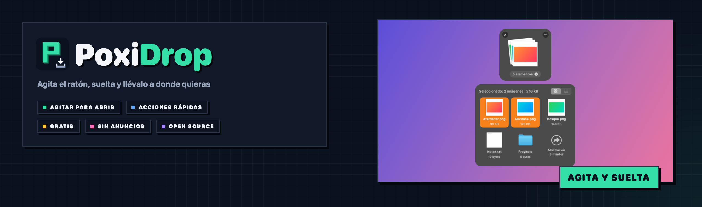
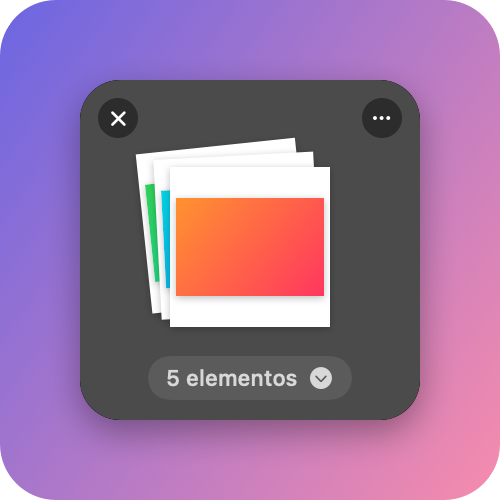
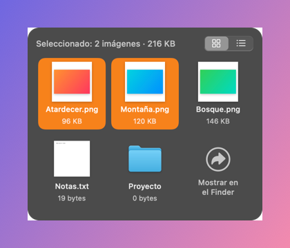
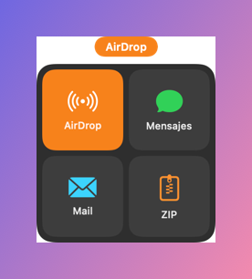
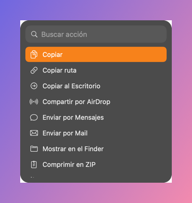

<div align="center">



<br />


**🇪🇸 Español** · [🇬🇧 English](#-english)

### Agita el ratón, **suelta** y llévalo a donde quieras.

Coges un archivo, una carpeta, una imagen o un texto, lo agitas mientras lo arrastras y aparece una
**estantería** flotante. Lo sueltas ahí, cambias de app tranquilamente y, cuando quieras, lo sacas a donde sea.

</div>

---

## 🎯 Qué es

**PoxiDrop** es una alternativa gratuita y open source a [Dropover](https://dropoverapp.com): estanterías
flotantes para arrastrar y soltar sin tener que tener las dos ventanas a la vista. Con el mismo estilo
de vidrio nativo de macOS, más acciones rápidas sobre lo que sueltas, y todo en castellano.

## 📸 Así se ve

<table>
  <tr>
    <td width="50%"></td>
    <td width="50%"></td>
  </tr>
  <tr>
    <td align="center"><sub>🗂️ La estantería: tus cosas apiladas, listas para sacarlas</sub></td>
    <td align="center"><sub>🔎 El detalle: elige qué sacar, vista rápida y tamaños</sub></td>
  </tr>
  <tr>
    <td width="50%"></td>
    <td width="50%"></td>
  </tr>
  <tr>
    <td align="center"><sub>⚡ Acciones directas: suelta encima y se envía por AirDrop, Mensajes, Mail o a un ZIP</sub></td>
    <td align="center"><sub>⌨️ Buscador de acciones: escribe y pulsa Intro</sub></td>
  </tr>
</table>

<sub>Capturas generadas con datos de ejemplo. En tu Mac el fondo de la estantería es de vidrio y toma el color de lo que hay detrás, y la selección usa tu color de acento.</sub>

## 📥 Descarga

| Archivo | Para qué |
|---|---|
| **[`PoxiDrop-0.1.1.dmg`](https://github.com/PoxiiTV/PoxiDrop/releases/download/v0.1.1/PoxiDrop-0.1.1.dmg)** | **Instalador** (0,6 MB): ábrelo y arrastra PoxiDrop a Aplicaciones |

Todas las versiones y sus novedades, en [**Releases**](https://github.com/PoxiiTV/PoxiDrop/releases).

> ℹ️ Como la app aún no está firmada por Apple, macOS la bloquea la primera vez. Ábrela, cierra el aviso y ve a
> **Ajustes del Sistema → Privacidad y seguridad → Abrir igualmente**. Solo hace falta una vez.
>
> 📍 PoxiDrop **no sale en el Dock**: vive en la barra de menús, arriba a la derecha (icono de la bandeja).

---

## 🌟 Lo que lo hace distinto

| | |
|---|---|
| 👋 **Agita para abrir** | Arrastra algo y muévelo rápido de lado a lado: aparece una estantería justo debajo del cursor. Sensibilidad ajustable |
| ⌨️ **O con una tecla, o en la muesca** | Mantén ⇧, ⌃, ⌥ o ⌘ mientras arrastras, o lleva lo que arrastras hasta la muesca del MacBook |
| 🗂️ **Varias estanterías** | Las que quieras a la vez, con nombre automático («5 imágenes»), favorita fija, recientes y acopladas a un borde de la pantalla |
| 🔎 **Detalle** | Cuadrícula o lista, selección, Vista rápida con espacio y arrastre de elementos sueltos |
| ⚡ **Acciones** | Comprimir en ZIP, copiar o mover a una carpeta, renombrar, AirDrop, Mensajes, Mail, redimensionar, convertir y comprimir imágenes, quitar metadatos, unir imágenes, extraer texto (OCR), crear PDF y pasar a texto plano |
| 🧩 **Tus scripts** | Añade tus propios scripts en «Mis acciones»: reciben los archivos y lo que creen vuelve a la estantería |
| 🔒 **Sin permisos raros** | No pide Accesibilidad ni grabación de pantalla. Nunca toca tus originales: los resultados se guardan aparte |
| 💸 **Gratis** | Sin suscripción, sin anuncios y con el código aquí |

## 🪶 Consumo

Medido en un MacBook Pro M5:

| | |
|---|---|
| En reposo | **~46 MB** de RAM, **0 %** de CPU y ningún despertar del procesador |
| Con 50 estanterías abiertas y su detalle (100 ventanas) | ~118 MB |
| Tras cerrarlas | vuelve a bajar: sin fugas en rondas repetidas |

Solo vigila el ratón mientras mantienes pulsado el clic (20 veces por segundo, y 60 durante un arrastre para
detectar bien el agitado). Las miniaturas son pequeñas y se olvidan cuando el archivo sale de las estanterías.

## 🚀 Cómo se usa

1. Empieza a arrastrar cualquier cosa (un archivo del Finder, una imagen de una web, un texto…).
2. **Agita el ratón** de lado a lado: aparece la estantería. Suelta encima.
3. Cuando quieras, arrastra desde la estantería a donde sea. Pulsa la píldora «N elementos» para ver el detalle
   o el botón **…** para las acciones.

Atajos globales: **⌃⌥D** nueva estantería · **⌃⌥V** estantería con el portapapeles · **⌃⌥S** mostrar u ocultar.

## ⚠️ Avisos

- 👋 Si te cuesta que salte la estantería o salta sin querer, cambia la sensibilidad del agitado en
  **Ajustes → Activación**.
- 📁 Lo que sueltas se guarda como **referencia** al archivo original (no se copia). El texto y las imágenes de
  webs sí se guardan como archivo propio.
- 🍎 Solo para Macs con **Apple Silicon** y macOS 14 o superior.

---

## 🔧 Compilar

Basta con las Command Line Tools de Xcode (no hace falta Xcode completo).

```bash
scripts/test.sh                          # tests de la lógica
swift run PoxiDrop                       # la app en modo desarrollo
.build/debug/PoxiDrop --snapshot capturas  # capturas con datos de ejemplo
.build/release/PoxiDrop --medir            # memoria con 50 estanterías abriéndose y cerrándose
scripts/make-app.sh                      # build/PoxiDrop.app
scripts/make-dmg.sh                      # build/PoxiDrop-<versión>.dmg
```

### 🗃️ Estructura

```
Sources/PoxiDropCore/   lógica sin interfaz y con tests: agitado, estanterías, importar, acciones
Sources/PoxiDrop/       la app: barra de menús, vigía de arrastre, estanterías, detalle, ajustes
Tests/                  tests de PoxiDropCore (swift-testing)
scripts/                tests, icono, .app, .dmg y banner
docs/superpowers/       diseño y plan de implementación
```

Las novedades, en [`CHANGELOG.md`](CHANGELOG.md).

## 🙏 Gracias a

- [**Dropover**](https://dropoverapp.com), la app que inspira esta. Si quieres funciones en la nube, apoya a su desarrollador.

## 📜 Licencia

PoxiDrop es software libre bajo **[GPL-3.0](LICENSE)**.

---

## 🇬🇧 English

<div align="center">

### Shake the mouse, **drop** it, and take it wherever you want.

</div>

## 🎯 What it is

**PoxiDrop** is a free, open source alternative to [Dropover](https://dropoverapp.com) for macOS. While you drag
something (files, folders, images, text), **shake the mouse** and a floating **shelf** appears. Drop it there,
switch apps, and drag it out wherever you like later. The interface is in Spanish.

## 📥 Download

| File | What for |
|---|---|
| **[`PoxiDrop-0.1.1.dmg`](https://github.com/PoxiiTV/PoxiDrop/releases/download/v0.1.1/PoxiDrop-0.1.1.dmg)** | **Installer** (0.6 MB): open it and drag PoxiDrop to Applications |

> ℹ️ The app is not signed by Apple yet, so macOS blocks it the first time. Open it, close the warning and go to
> **System Settings → Privacy & Security → Open Anyway**. It lives in the menu bar, not in the Dock.

## 🌟 Highlights

- 👋 **Shake to open** a shelf while dragging, or hold a modifier key, or drag to the MacBook notch.
- 🗂️ **Multiple shelves**, favorite, recents, docking to a screen edge and a detail view with Quick Look.
- ⚡ **Actions**: ZIP, copy/move, rename, AirDrop, Messages, Mail, resize/convert/compress images, strip metadata,
  stitch, OCR, make PDF, plain text and your own scripts.
- 🔒 **No special permissions** and your originals are never modified.

## ⚠️ Notices

- 👋 If the shelf is hard to trigger or pops up by accident, tune the shake sensitivity in Settings.
- 🪶 **Light**: ~46 MB of RAM and 0 % CPU when idle, no memory leaks.
- 🍎 **Apple Silicon** and macOS 14+ only for now.

## 📜 License

Free software under **[GPL-3.0](LICENSE)**.
